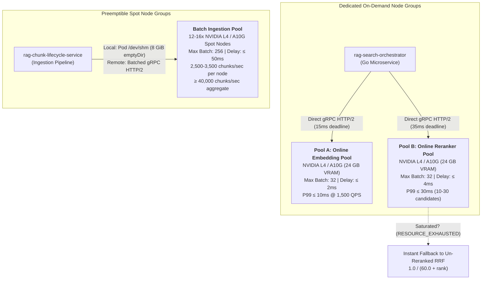
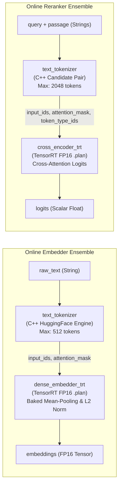
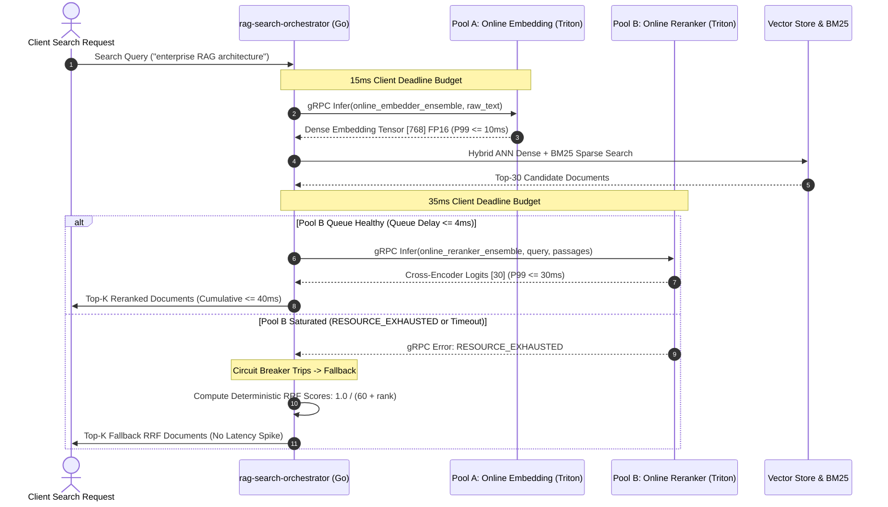
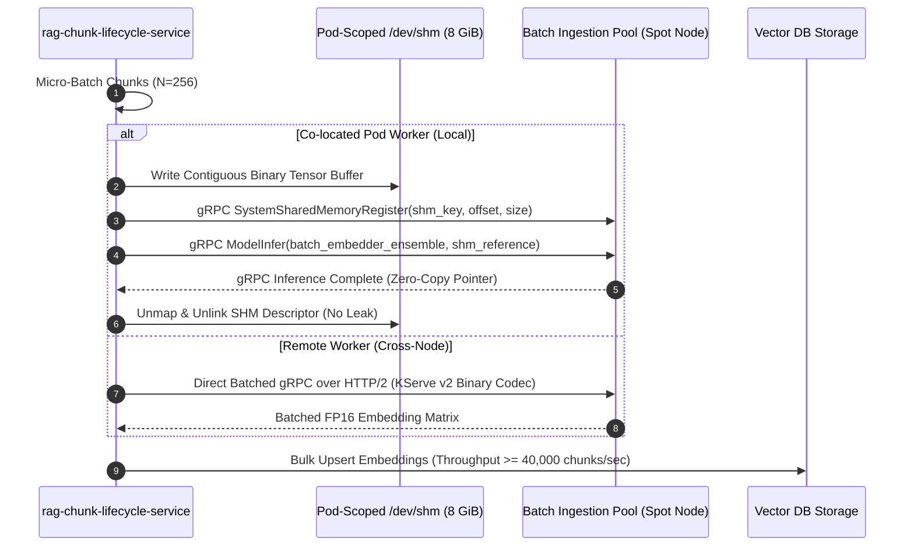

# Architecture Specification - RAG Inference Serving (`rag-inference-serving`)

This document defines the production architecture for the **`rag-inference-serving`** microservice—the hardware-accelerated embedding generation and candidate reranking subsystem of the enterprise Retrieval-Augmented Generation (RAG) platform.

---

## 1. Executive Summary & Strategic Objectives

The `rag-inference-serving` subsystem provides horizontally scalable, hardware-accelerated model inference across the disaggregated RAG platform. It serves dense query embeddings, cross-encoder rerankers, and high-density batch document embeddings for online query execution and offline document ingestion workflows (sparse lexical retrieval is handled upstream by the search orchestrator).

### Strategic Architecture Directives
1. **Decoupled Cluster Topologies**: Physically isolate latency-sensitive online retrieval serving from high-throughput offline batch ingestion to eliminate GPU Streaming Multiprocessor (SM) thread starvation and dynamic queue thrashing.
2. **Hardware-Isolated Serving**: Separate compute-intensive cross-encoder rerankers from dense query embedders across discrete GPU node pools to prevent dense $O(N)$ matrix multiplications from breaching online retrieval latency SLOs.
3. **Direct-to-Runtime Transport**: Connect upstream orchestrators directly to NVIDIA Triton Inference Server via low-latency gRPC channels with HTTP/2 keepalive pooling, and provide zero-copy POSIX shared memory (`/dev/shm`) IPC mounts for co-located ingestion pipelines—completely eliminating intermediate data-plane sidecar proxies (ADR-005).
4. **In-Engine C++ Tokenization & Triton Ensembles**: Execute tokenization directly inside the Triton inference engine via C++ tokenizer runtimes chained to TensorRT FP16 engines using Triton Ensemble Pipelines, eliminating Python Global Interpreter Lock (GIL) bottlenecks.
5. **Native Queue Bounds & Fast Fallback**: Enforce Triton-native dynamic batch queue timeouts (`max_queue_delay_microseconds`). When queues saturate, emit standard error status codes (`RESOURCE_EXHAUSTED` / HTTP 429) to trigger immediate, deterministic un-reranked Reciprocal Rank Fusion (RRF) fallback in upstream orchestrators.
6. **Standardized FP16 Precision**: Standardize purely on FP16 TensorRT engine serialization (`model.plan`) in initial phases, avoiding score degradation on embedding vector spaces and quantization maintenance overhead.

---

## 2. Decoupled Compute Pool Topologies & Calibrated SLO Matrix

The inference serving subsystem is partitioned into **three physically decoupled GPU compute pools** deployed on isolated Kubernetes node groups:



### Calibrated Quantitative SLOs & Operational Invariants

| Pool Identity | Target Hardware | Node Group Strategy | Dynamic Batch Ceiling | Max Queue Delay | Quantitative SLI / SLO Target |
| :--- | :--- | :--- | :--- | :--- | :--- |
| **Pool A: Online Embedding** | 1x NVIDIA L4 / A10G (24 GB) | Dedicated On-Demand | Max Batch: 32 | $\le 2\text{ ms}$ ($2000\mu\text{s}$) | Standalone P99 $\le 10\text{ ms}$ at 1,500 single-sentence queries/sec per GPU instance |
| **Pool B: Online Reranker** | 1x NVIDIA L4 / A10G (24 GB) | Dedicated On-Demand | Max Batch: 32 | $\le 4\text{ ms}$ ($4000\mu\text{s}$) | Standalone P99 $\le 30\text{ ms}$ for 10–30 candidate pairs under sustained load |
| **Batch Ingestion Pool** | 12–16x NVIDIA L4 / A10G | Preemptible Spot | Max Batch: 256 | $\le 50\text{ ms}$ ($50000\mu\text{s}$) | $2{,}500\text{--}3{,}500\text{ chunks/sec}$ per node; aggregate $\ge 40{,}000\text{ chunks/sec}$ across cluster |

**Cumulative Search Budget**: Standalone dense embedding target (P99 $\le 10\text{ ms}$, bounded by a $15\text{ ms}$ client deadline) + cross-encoder reranking target (P99 $\le 30\text{ ms}$, bounded by a $35\text{ ms}$ client deadline) defines an explicit component inference budget totaling **$\le 40\text{ ms}$ P99 cumulative inference latency** (within an end-to-end retrieval budget accounting for vector-store retrieval and sequential client timeouts up to $50\text{ ms}$).

---

## 3. Production-Grade 5-Layer Backend Architecture

The microservice architecture maps strictly to the **5 Production Grade Backend Layers**:

```
┌────────────────────────────────────────────────────────────────────────┐
│ Layer 1: API & Routing                                                 │
│ Direct gRPC (KServe v2) | Operational FastAPI (ASGI Port 8080)         │
│ Triton Ensembles       | Dynamic Shape Profiles & C++ Kernel Gates     │
└───────────────────────────────────┬────────────────────────────────────┘
                                    │
┌───────────────────────────────────▼────────────────────────────────────┐
│ Layer 2: Data Persistence & Memory Models                              │
│ Read-Only NVMe Model CSI | Pod-Scoped POSIX /dev/shm (8 GiB emptyDir) │
│ Zero Persistent DB State | Remote Batched gRPC Stream (Zero-Copy Views)│
└───────────────────────────────────┬────────────────────────────────────┘
                                    │
┌───────────────────────────────────▼────────────────────────────────────┐
│ Layer 3: Architecture & Scale                                          │
│ Hardware-Isolated Pools: Pool A (Embed), Pool B (Rerank), Batch Pool   │
│ KEDA Metric Autoscaling (Queue Duration & Kafka Lag)                   │
└───────────────────────────────────┬────────────────────────────────────┘
                                    │
┌───────────────────────────────────▼────────────────────────────────────┐
│ Layer 4: Security & Identity                                           │
│ Hardened Non-Root (UID 1000) | Secured Structured Logging (Redacted)   │
│ 12-Factor Env Configuration  | Static VRAM Cap (<=20 GiB) & Alert (>85%)│
└───────────────────────────────────┬────────────────────────────────────┘
                                    │
┌───────────────────────────────────▼────────────────────────────────────┐
│ Layer 5: Observability & Quality                                       │
│ Prometheus Triton Metrics | Resilient 3-State Circuit Breaker (RRF)    │
│ Liveness/Readiness Probes | Chaos Resilience & Spot Eviction Handlers  │
└────────────────────────────────────────────────────────────────────────┘
```

---

### Layer 1: API & Routing
*Digital entryways, contracts, and flow control.*

1. **Dual-Process Entry Points**:
   - Managed by the supervisor script (`deployments/docker/entrypoint.sh`).
   - **Data Plane (NVIDIA Triton)**: KServe v2 binary tensor gRPC on port `8001`, HTTP on port `8000`, and Prometheus metrics on port `8002`.
   - **Control & Operational Plane (FastAPI ASGI)**: Out-of-band server on port `8080` providing liveness/readiness probes, metrics exposition, and OpenAPI 3.1 documentation.
2. **Endpoints & Contracts**:
   - **Operational Endpoints (`internal/server/probe_server.py`)**:
     - `GET /healthz`: Lightweight liveness probe returning HTTP 200 `{"status": "healthy"}` if the supervisor event loop is active.
     - `GET /ready`: Readiness probe verifying GPU caches, Triton model engine availability, and VRAM headroom.
     - `GET /metrics`: Prometheus metric exposition.
     - `GET /docs` & `GET /redoc`: Interactive Swagger UI and ReDoc documentation.
     - `GET /api/docs` & `GET /openapi.json`: Machine-readable OpenAPI 3.1 JSON schemas.
   - **Triton Ensemble Endpoints (KServe v2)**:
     - `POST /v2/models/online_embedder_ensemble/infer`: Ingests `raw_text` strings, returns normalized FP16 embedding vectors.
     - `POST /v2/models/online_reranker_ensemble/infer`: Ingests `query` and `passage` strings, returns normalized scalar logits.
     - `POST /v2/models/batch_embedder_ensemble/infer`: Ingests bulk chunk arrays, returns batch FP16 embedding matrices.
3. **Dynamic Shape Profiles & Kernel Bound Gates**:
   - TensorRT engines enforce calibrated dynamic shape profiles `[min, opt, max]`:
     - Online Embedding: Batch $[1, 1, 32]$, Sequence Length $[1, 128, 512]$.
     - Online Reranker: Batch $[1, 10, 32]$, Sequence Length $[1, 256, 2048]$.
     - Batch Ingestion: Batch $[1, 128, 256]$, Sequence Length $[1, 256, 512]$.
   - In-engine C++ kernel bound gates deterministically truncate inputs exceeding maximum context limits (512 tokens for embeddings, 2048 tokens for cross-encoders) without raising exceptions or causing memory fragmentation.
4. **Native Backpressure & Throttling**:
   - Configured via Triton dynamic batching `default_queue_policy` with `timeout_action: REJECT` and `max_queue_size`.
   - Saturated queues return standard error status `RESOURCE_EXHAUSTED` (gRPC status 8) or HTTP 429 rather than queueing indefinitely, enabling upstream callers to instantly fall back.
5. **Idempotency**:
   - All inference endpoints are purely functional mathematical projections; identical string inputs produce deterministic tensor outputs.

---

### Layer 2: Data Persistence & Memory Models
*Data integrity, retrieval, and memory isolation.*

1. **Zero Persistent DB State**:
   - The serving tier is completely stateless. No operational transactional database tables, migrations, or local mutable state exist.
2. **Read-Only NVMe Model Storage**:
   - Model weights and serialized TensorRT FP16 engine plans (`model.plan`) are mounted as read-only volumes via Kubernetes CSI drivers (`/models/...`).
   - Ensures immutable runtime execution and instant container restarts without weight download delays.
3. **Pod-Scoped POSIX Shared Memory IPC (`/dev/shm`)**:
   - Sized to an 8 GiB Kubernetes `emptyDir` RAM volume (`medium: Memory`).
   - Strictly reserved for zero-copy tensor exchanges between **co-located containers within the same Kubernetes Pod** (e.g. batch chunk ingestion worker and Triton).
   - Enforced by `validate_pod_boundary()` (`internal/shm/posix_shm.py`): cross-pod or cross-node access attempts raise `PodBoundaryViolationError` to prevent `SIGBUS` faults.
   - Deterministic resource reclamation: `SharedMemoryRegion` context managers guarantee `munmap` and `shm_unlink` cleanup on every transaction to prevent kernel leaks.
4. **Remote Ingestion Transport**:
   - Remote workers communicate over batched gRPC over HTTP/2 using zero-copy NumPy memoryviews (`internal/client/kserve_codec.py`).

---

### Layer 3: Architecture & Scale
*Managing concurrency, workload separation, and uptime.*

1. **Physical Compute Pool Decoupling**:
   - **Pool A (Online Embedding)**: Dedicated NVIDIA L4/A10G GPUs on on-demand Kubernetes nodes with node affinity and taints (`node.kubernetes.io/instance-type`, `pool=online-embedding`).
   - **Pool B (Online Reranker)**: Dedicated NVIDIA L4/A10G GPUs on on-demand Kubernetes nodes (`pool=online-reranker`).
   - **Batch Ingestion Pool**: 12–16x NVIDIA L4/A10G GPUs on preemptible spot node groups (`pool=batch-ingestion`, `cloud.google.com/gke-spot: "true"`).
2. **High-Performance gRPC Connection Pooling (`internal/client/grpc_pool.py`)**:
   - Thread-safe `TritonGRPCChannelPool` maintaining dedicated HTTP/2 channels per pool.
   - Production keepalive configuration:
     - `grpc.keepalive_time_ms = 10000` (10s pings)
     - `grpc.keepalive_timeout_ms = 5000` (5s ack timeout)
     - `grpc.keepalive_permit_without_calls = 1`
     - `grpc.max_receive_message_length = 64MB`
     - `grpc.max_send_message_length = 64MB`
3. **Dynamic Micro-Batching**:
   - Batch client (`internal/client/batch_client.py`) slices arbitrary document streams into micro-batches of $N \le 256$.
   - Triton server-side dynamic batch scheduler merges concurrent client requests within the configured queue delay window ($\le 2\text{ ms}$, $\le 4\text{ ms}$, $\le 50\text{ ms}$).
4. **High Availability & Autoscaling**:
   - Online pools are replicated across 3 Availability Zones (AZs) with PodDisruptionBudgets (`minAvailable: 75%`).
   - Autoscaled via **KEDA (Kubernetes Event-driven Autoscaling)** evaluating average queue duration per request and Kafka consumer group backlog.

---

### Layer 4: Security & Identity
*Hardening access, environment isolation, and operational safety.*

1. **Container Hardening & Non-Root Execution**:
   - Docker image (`deployments/docker/Dockerfile.triton`) runs as unprivileged user `USER 1000:1000`.
   - Read-only root filesystem with explicit `/tmp/triton` and `/dev/shm` ephemeral mounts.
2. **12-Factor Configuration & Secrets Decoupling**:
   - Microservice configuration is managed via [`.env.example`](.env.example) and Pydantic [`ServingSettings`](internal/config/settings.py) with the `RAG_SERVING_` namespace.
   - No credentials, tokens, or private keys are baked into images or stored in git.
3. **Secured Structured JSON Logging (`internal/logging/secured_logger.py`)**:
   - Outputs machine-parseable JSON lines with standardized correlation fields (`request_id`, `model_name`, `pool_type`, `batch_size`, `latency_ms`).
   - **Zero Raw Payload Leakage Guarantee**: Strictly redacts query text, chunk contents, float embedding arrays, bearer tokens, and presigned URLs.
   - Traceback and path sanitization: strips local paths and hexadecimal memory addresses before emission.
4. **VRAM Ceilings & Dynamic Headroom Protection**:
   - **Static Model Allocation Ceiling**: $\le 20\text{ GiB}$ ($83.33\%$ of 24 GiB), reserving $\ge 4\text{ GiB}$ dedicated dynamic activation headroom.
   - **Runtime Memory Threshold Guard**: Active VRAM utilization $>85\%$ ($>20.4\text{ GiB}$) immediately forces the `/ready` probe to return HTTP 503, shedding inbound traffic before a CUDA Out-of-Memory (OOM) termination occurs.

---

### Layer 5: Observability & Quality
*Diagnostics, operational monitoring, and resilience.*

1. **Observability & Metrics**:
   - Triton server exports native Prometheus metrics on port `8002` (`triton_queue_duration_microseconds`, `triton_inference_count`, `triton_gpu_memory_used_bytes`).
   - Out-of-band operational ASGI server aggregates and exposes `/metrics` on port `8080`.
2. **Resilient Circuit Breaker & Un-Reranked RRF Fallback (`internal/client/circuit_breaker.py`)**:
   - Thread-safe 3-state machine (`CLOSED`, `OPEN`, `HALF_OPEN`).
   - Trips to `OPEN` on consecutive failure threshold ($N=3$) of `RESOURCE_EXHAUSTED`, `DEADLINE_EXCEEDED`, or `UNAVAILABLE`.
   - Under `OPEN` state, instantly returns deterministic Reciprocal Rank Fusion (RRF) scores without degrading retrieval latency:
     $$RRF(d) = \frac{1.0}{60.0 + rank(d)}$$
3. **Chaos Resilience & Spot Eviction Handling**:
   - Spot node termination signals (`SIGTERM`) trigger immediate client channel recycling and request retry to healthy nodes.
   - Zero orphaned shared memory segments or leaked file descriptors during sudden node preemption.

---

## 4. In-Engine C++ Tokenizer & Triton Ensemble Pipelines

To eliminate the Python Global Interpreter Lock (GIL) and serialize inference into a single round-trip, text tokenization executes directly inside the Triton engine pipeline:



### Ensemble Pipeline Configurations
1. **`online_embedder_ensemble` (`config/triton/online_embedding_repository/`)**:
   - `text_tokenizer`: Dynamic batching up to 32, max tokens 512.
   - `dense_embedder_trt`: FP16 TensorRT engine with baked mean-pooling layer and L2 normalization kernel. Outputs 768 or 1536-dimensional FP16 vectors.
2. **`online_reranker_ensemble` (`config/triton/online_reranker_repository/`)**:
   - `text_tokenizer`: Pairs query and document candidate text up to 2048 tokens.
   - `cross_encoder_trt`: FP16 TensorRT engine evaluating multi-head cross-attention. Outputs normalized scalar relevance logits.
3. **`batch_embedder_ensemble` (`config/triton/batch_ingestion_repository/`)**:
   - Throughput-optimized pipeline supporting $1 \le \text{batch} \le 256$ with 50 ms delay ceiling.

---

## 5. End-to-End Sequence & Data Flows

### Online Query Retrieval Sequence (Dense Search + Reranking)


### High-Throughput Batch Chunk Ingestion Sequence


---

## 6. Sizing, Deployment Matrix & Autoscaling Architecture

### Sizing & Deployment Matrix

| Parameter | Online Embedding Pool | Online Reranker Pool | Batch Ingestion Pool |
| :--- | :--- | :--- | :--- |
| **GPU Hardware** | 1x NVIDIA L4 or A10G (Dedicated) | 1x NVIDIA L4 or A10G (Dedicated) | 1x NVIDIA L4 or A10G (Preemptible Spot) |
| **Kubernetes Node Group** | On-Demand Node Group | On-Demand Node Group | Preemptible Spot Node Group |
| **Dynamic Batching** | Max Batch: 32, Delay: 2 ms | Max Batch: 32, Delay: 4 ms | Max Batch: 256, Delay: 50 ms |
| **Target Workload** | Single-sentence query vectors | Top-10 to Top-30 candidate pairs | Bulk document chunk arrays (256–512 tokens) |
| **Replica Bounds** | Min: 4, Max: 8 across AZs | Min: 4, Max: 12 across AZs | Min: 12, Max: 16 (scale on lag) |
| **Autoscaling Driver** | Average queue duration per request | Average queue duration per request | Kafka consumer group task backlog |
| **KEDA Trigger Threshold** | Delay $\ge 3000\mu\text{s}$ ($3\text{ ms}$) | Delay $\ge 5000\mu\text{s}$ ($5\text{ ms}$) | Backlog $\ge 10{,}000$ chunks |

### Calibrated KEDA Metric Autoscaling Trigger Query
Autoscaling evaluates the **average queue delay per request** rather than raw counter accumulation:

$$\text{Avg Queue Delay } (\mu\text{s}) = \frac{\sum(\text{rate}(\text{triton\_queue\_duration\_microseconds}[\text{1m}]))}{\text{clamp\_min}(\sum(\text{rate}(\text{triton\_inference\_count}[\text{1m}])), 1)}$$

```yaml
triggers:
  - type: prometheus
    metadata:
      serverAddress: http://prometheus-k8s.monitoring.svc:9090
      metricName: triton_queue_duration_microseconds
      threshold: "3000"
      query: sum(rate(triton_queue_duration_microseconds{pool="online_embedding"}[1m])) / clamp_min(sum(rate(triton_inference_count{pool="online_embedding"}[1m])), 1)
```

---

## 7. Telemetry, Alerting Thresholds & Operational Runbooks

### Telemetry & Alerting Thresholds

| Alert Name | Severity | Metric / Condition | Action Required |
| :--- | :--- | :--- | :--- |
| `EmbeddingQueueLagAlert` | **Warning** | Online embedding queue delay $> 4\text{ ms}$ for $> 1\text{ min}$ | Verify incoming traffic spike; ensure KEDA HPA scales replicas up to 8. |
| `RerankerQueueLagAlert` | **Warning** | Online reranker queue delay $> 8\text{ ms}$ for $> 1\text{ min}$ | Verify candidate depths; confirm upstream orchestrators fallback to un-reranked RRF. |
| `GPUVRAMSaturationAlert` | **Critical** | Active memory allocation $> 85\%$ ($> 20.4\text{ GiB}$) on any GPU | `/ready` probe sheds traffic (503); check max context length compliance and inspect for memory fragmentation. |
| `IngestionBacklogAlert` | **Warning** | Batch task backlog $> 500{,}000$ chunks with 16 spot nodes | Scale cluster node pool ceiling or adjust batch queue delay parameter. |

### Operational Runbooks

#### Runbook 1: Online Queue Wait Time Alerts
1. Inspect `triton_queue_duration_microseconds` on the affected online deployment (`values-online-embed.yaml` or `values-online-rerank.yaml`).
2. If queue delay exceeds warning thresholds ($4\text{ ms}$ for embeddings, $8\text{ ms}$ for rerankers), check whether incoming QPS exceeds calibrated capacity ($1,500\text{ QPS}$ per GPU).
3. Confirm that KEDA has scaled replica pods across the on-demand node group.
4. Verify that upstream `rag-search-orchestrator` instances have engaged circuit breaking and are serving un-reranked RRF scores without user-facing latency breaches.

#### Runbook 2: Managing CUDA Out-Of-Memory Conditions
1. Inspect `triton_gpu_memory_used_bytes` across GPU nodes via Prometheus or `nvidia-smi`.
2. Verify that input text sequences conform to context limits ($512$ tokens for embeddings, $2048$ tokens for cross-encoders).
3. Ensure dynamic batch size ceilings are respected ($N \le 32$ for online pools, $N \le 256$ for batch ingestion).
4. Restart affected worker pods to re-initialize contiguous, unfragmented CUDA memory allocations.

#### Runbook 3: Ingestion Cluster Throughput Lags
1. Monitor aggregate vector ingestion throughput across the spot GPU pool.
2. Check Kafka topic lag driving `rag-chunk-lifecycle-service`.
3. If aggregate throughput falls below $40{,}000\text{ chunks/sec}$, scale out spot node group replicas up to the 16-node maximum.

---

## 8. Architectural Decision Records (ADRs)

### ADR-001: Decoupling Compute Pools (Online vs. Batch)
- **Context**: Document ingestion involves sustained, dense matrix multiplication over tens of thousands of chunks, while online search requires single-digit millisecond response times.
- **Decision**: Partition hardware into dedicated On-Demand node groups for online search and Preemptible Spot node groups for batch ingestion.
- **Consequences**: Eliminates GPU Streaming Multiprocessor contention; online retrieval latency remains invariant during peak document ingestion.

### ADR-002: Dedicated Cross-Encoder Node Pools
- **Context**: Cross-encoder models compute full cross-attention over concatenated query-passage pairs ($O((L_q + L_p)^2)$), which is orders of magnitude more compute-intensive than bi-encoder query embedding.
- **Decision**: Separate cross-encoder rerankers (Pool B) from dense embedding models (Pool A) onto distinct GPU instances.
- **Consequences**: Guarantees that reranker saturation does not degrade standalone dense query embedding P99 latencies.

### ADR-003: Standard FP16 Model Compilation
- **Context**: Quantizing dense embedding models to INT8 or INT4 can warp semantic distances and degrade retrieval precision.
- **Decision**: Standardize all models as TensorRT FP16 engines (`model.plan`) in initial production phases.
- **Consequences**: Delivers high throughput without score degradation or quantization maintenance overhead.

### ADR-004: In-Engine C++ Tokenization & Triton Ensembles
- **Context**: Running HuggingFace Python tokenizers in external worker processes incurs severe Python Global Interpreter Lock (GIL) stalls and multi-process IPC overhead.
- **Decision**: Implement tokenizers directly inside Triton model repositories as C++ runtimes chained into Triton Ensemble Pipelines.
- **Consequences**: Provides zero-GIL single-round-trip inference; removes Python from the hot inference path.

### ADR-005: Elimination of Intermediate Data-Plane Sidecars
- **Context**: Intermediate sidecars (e.g. Apache Arrow Flight proxies) introduce extra network hops, memory copies, and garbage collection pressure.
- **Decision**: Upstream search orchestrators connect directly to Triton over gRPC HTTP/2 channels with connection pooling, and batch ingestion pipelines use pod-scoped `/dev/shm` POSIX shared memory.
- **Consequences**: Minimal data-plane latency and zero CPU memory copy overhead.
