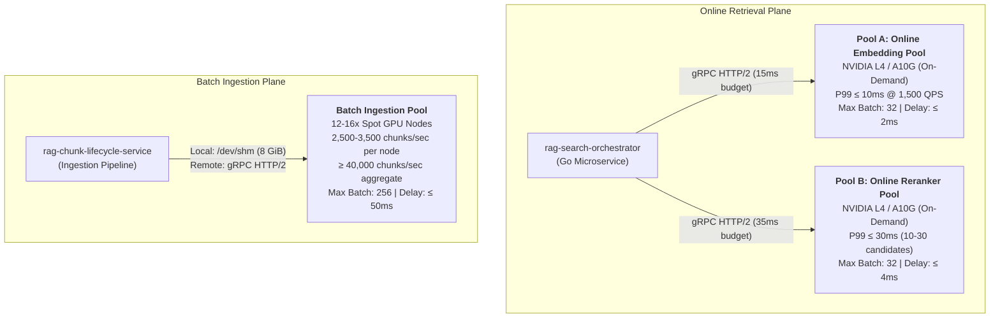

# RAG Inference Serving (`rag-inference-serving`)

Hardware-accelerated embedding generation and candidate reranking microservice for enterprise Retrieval-Augmented Generation (RAG) platforms. Built on **NVIDIA Triton Inference Server**, **TensorRT FP16 engines**, **in-engine C++ tokenizers**, **KServe v2 binary tensor codecs**, and **KEDA autoscaling**.

---

## 1. Architectural Overview & Compute Pool Topology

To protect online search latencies from high-volume document ingestion workloads and prevent GPU Streaming Multiprocessor (SM) thread stalls, compute is partitioned into **three physically decoupled GPU pools** across isolated Kubernetes node groups:



### Decoupled Pool Hardware & SLO Matrix

| Pool Identity | Target Hardware | Node Group Lifecycle | Queue Delay Ceiling | Max Batch Size | Calibrated SLI / SLO Target |
| :--- | :--- | :--- | :--- | :--- | :--- |
| **Pool A: Online Embedding** | NVIDIA L4 / A10G (24 GB) | Dedicated On-Demand | $\le 2\text{ ms}$ | 32 | P99 latency $\le 10\text{ ms}$ at 1,500 single-sentence QPS |
| **Pool B: Online Reranker** | NVIDIA L4 / A10G (24 GB) | Dedicated On-Demand | $\le 4\text{ ms}$ | 32 | P99 latency $\le 30\text{ ms}$ for 10–30 candidate document pairs |
| **Batch Ingestion Pool** | 12–16x NVIDIA L4 / A10G | Preemptible Spot | $\le 50\text{ ms}$ | 256 | $2{,}500\text{--}3{,}500\text{ chunks/sec}$ per node; aggregate $\ge 40{,}000\text{ chunks/sec}$ |

Cumulative search budget: **$\le 40\text{ ms}$ P99** (dense embedding + cross-encoder reranking).

---

## 2. In-Engine C++ Tokenization & Triton Ensemble Pipelines

Tokenization executes directly inside the Triton inference engine via C++ tokenizer runtimes chained to TensorRT FP16 engines using Triton Ensemble Pipelines, eliminating Python Global Interpreter Lock (GIL) bottlenecks:

- `online_embedder_ensemble`: Chains `text_tokenizer` (512 max tokens) $\rightarrow$ `dense_embedder_trt` (FP16 `.plan` with baked mean-pooling and L2 normalization).
- `online_reranker_ensemble`: Chains candidate pair tokenizer (`query` + `passage`, 2048 max tokens) $\rightarrow$ `cross_encoder_trt` (FP16 `.plan` producing normalized scalar logits).
- `batch_embedder_ensemble`: Chains high-throughput tokenizer (512 max tokens) $\rightarrow$ `dense_embedder_trt` ($1 \le \text{batch} \le 256$).

---

## 3. High-Performance Client Integration & Native Circuit Breaking

- **KServe v2 Binary Tensor Codec (`internal/client/kserve_codec.py`)**: Pack/unpack string tensors using 4-byte little-endian length prefixes and FP16 byte buffers using NumPy zero-copy memoryviews.
- **gRPC Connection Pooling (`internal/client/grpc_pool.py`)**: Discrete channel pools maintaining dedicated HTTP/2 keepalive connections per pool type.
- **Resilient Circuit Breaker (`internal/client/circuit_breaker.py`)**: 3-state machine (`CLOSED`, `OPEN`, `HALF_OPEN`) tripping on Triton queue saturation (`RESOURCE_EXHAUSTED`), timeouts (`DEADLINE_EXCEEDED`), or unavailability (`UNAVAILABLE`).
- **Un-Reranked RRF Fallback**: When circuit breaker trips, instantly emits deterministic Reciprocal Rank Fusion (RRF) scores without degrading retrieval latency:
  $$RRF(d) = \frac{1.0}{60.0 + rank(d)}$$
- **Secured Logging**: Structured JSON logging strictly redacting raw query text, chunk payloads, and raw tensor floats.

---

## 4. Setup, Model Export & TensorRT Compilation

### Prerequisites
- Python 3.11+
- CUDA 12.4+ and TensorRT 10.x (for live GPU inference)
- NVIDIA Container Toolkit & Docker

### Local Environment Setup
```bash
python -m venv .venv
source .venv/bin/activate  # On Windows: .venv\Scripts\activate
pip install -r requirements.txt  # Or install dependencies via pip
```

### Export ONNX & Tokenizers
```bash
# Export Dense Embedding ONNX model with baked pooling & normalization
python scripts/export_onnx.py --model-type embedding --output-path models/dense_embedder.onnx

# Export Cross-Encoder Reranker ONNX model
python scripts/export_onnx.py --model-type reranker --output-path models/cross_encoder.onnx

# Export Tokenizers to Triton Model Repositories
python scripts/export_tokenizer.py --model-type embedding --output-dir config/triton/online_embedding_repository/text_tokenizer/1
python scripts/export_tokenizer.py --model-type reranker --output-dir config/triton/online_reranker_repository/text_tokenizer/1
```

### Compile TensorRT FP16 Engines
```bash
# Compile with dry-run fallback or on live GPU with trtexec
python scripts/build_trt_engine.py --model-type online_embed --onnx-path models/dense_embedder.onnx --output-plan config/triton/online_embedding_repository/dense_embedder_trt/1/model.plan
python scripts/build_trt_engine.py --model-type online_rerank --onnx-path models/cross_encoder.onnx --output-plan config/triton/online_reranker_repository/cross_encoder_trt/1/model.plan
python scripts/build_trt_engine.py --model-type batch_ingest --onnx-path models/dense_embedder.onnx --output-plan config/triton/batch_ingestion_repository/dense_embedder_trt/1/model.plan
```

---

## 5. Running the Service

### Operational Probe Server (ASGI)
Run the out-of-band operational health and monitoring server:
```bash
uvicorn internal.server.probe_server:app --host 0.0.0.0 --port 8080
```
Operational endpoints:
- `GET /healthz` - Liveness probe (process supervisor status).
- `GET /ready` - Readiness probe (Triton status + VRAM headroom guard; sheds 503 if VRAM > 85% or static allocation > 20 GiB).
- `GET /metrics` - Prometheus metrics exposition.
- `GET /api/docs` or `GET /docs` - OpenAPI 3.1 interactive Swagger UI.
- `GET /openapi.json` - Raw OpenAPI 3.1 schema.

### Docker Container Build
```bash
make build-docker
# Or:
docker build -f deployments/docker/Dockerfile.triton -t rag-inference-serving:latest .
```

---

## 6. Testing, Benchmarks & Chaos Suite

Run tests via `make` or `pytest`:

```bash
# Run all checks and tests
make lint
make typecheck
make test

# Individual test suites
make test-unit
make test-integration
make test-benchmark
make test-chaos
```

### Benchmark Suite (`test/benchmark/`)
- `test_single_node_embedding_sweep.py`: Quantitative throughput ($2{,}500\text{--}3{,}500\text{ chunks/sec}$) and latency percentiles (P50, P90, P99) across batch sizes $1 \le N \le 256$, comparing `/dev/shm` zero-copy vs HTTP/2 gRPC.
- `test_multi_node_ingestion_scaling.py`: Horizontal scaling simulation across 12–16 spot GPU nodes asserting $\ge 40{,}000\text{ chunks/sec}$ aggregate throughput.
- `test_online_latency_profiler.py`: 100-request warm-up sweep, verifying 1,500 QPS Pool A P99 $\le 10\text{ ms}$, Pool B P99 $\le 30\text{ ms}$, and cumulative $\le 40\text{ ms}$ search budget.

### Chaos & Resilience Suite (`test/chaos/`)
- `test_queue_saturation_backpressure.py`: Saturates Triton dynamic batch queues, asserts `RESOURCE_EXHAUSTED` (gRPC status 8), verifies 3-state circuit breaker tripping and un-reranked RRF scores.
- `test_cuda_stall_injection.py`: Injects synthetic kernel delays exceeding deadlines (15 ms / 35 ms) and verifies rapid channel recycling.
- `test_hardware_isolation.py`: Floods batch ingestion pipeline while concurrently serving 1,500 QPS online queries, validating zero latency degradation and Kubernetes scheduling isolation.
- `test_spot_eviction.py`: Simulates Kubernetes spot instance termination signals (`SIGTERM`), verifying connection failover, task re-queueing without chunk loss, and clean `/dev/shm` resource reclamation.

---

## 7. Kubernetes KEDA Autoscaling & GitOps ArgoCD Deployment

### Calibrated KEDA Prometheus Trigger
Autoscaling scales on **average queue delay per request** rather than raw counter rates:
```yaml
query: sum(rate(triton_queue_duration_microseconds{pool="online_embedding"}[1m])) / clamp_min(sum(rate(triton_inference_count{pool="online_embedding"}[1m])), 1)
threshold: "3000"  # 3 ms trigger threshold
```

### GitOps ArgoCD ApplicationSet
Continuous delivery is declaratively managed across the 3 decoupled pools using ArgoCD:
```bash
kubectl apply -f deployments/argocd/applicationset.yaml
```
Deploys:
1. `rag-inference-online-embedding` targeting on-demand GPU nodes via `deployments/helm/values-online-embed.yaml`.
2. `rag-inference-online-reranker` targeting on-demand GPU nodes via `deployments/helm/values-online-rerank.yaml`.
3. `rag-inference-batch-ingestion` targeting preemptible spot GPU nodes via `deployments/helm/values-batch-ingestion.yaml`.

Canary progressive rollouts for TensorRT engine updates are managed via `deployments/argocd/rollout-canary.yaml`.
