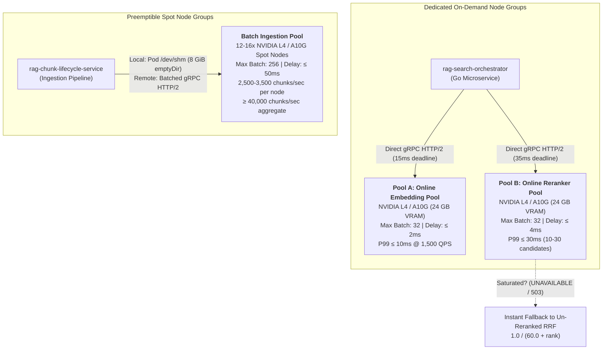

# RAG Inference Serving (`rag-inference-serving`)

Hardware-accelerated embedding generation and candidate reranking microservice for enterprise Retrieval-Augmented Generation (RAG) platforms. Built on **NVIDIA Triton Inference Server**, **TensorRT FP16 engines**, **in-engine C++ tokenizers**, **KServe v2 binary tensor codecs**, and **KEDA autoscaling**.

---

## 1. Architectural Overview & Compute Pool Topology

To protect online search latencies from high-volume document ingestion workloads and prevent GPU Streaming Multiprocessor (SM) thread stalls, compute is partitioned into **three physically decoupled GPU compute pools** across isolated Kubernetes node groups:



### Decoupled Pool Hardware & SLO Matrix

| Pool Identity | Target Hardware | Node Group Lifecycle | Queue Delay Ceiling | Max Batch Size | Calibrated SLI / SLO Target |
| :--- | :--- | :--- | :--- | :--- | :--- |
| **Pool A: Online Embedding** | 1x NVIDIA L4 / A10G (24 GB) | Dedicated On-Demand | $\le 2\text{ ms}$ ($2000\mu\text{s}$) | 32 | Standalone P99 latency $\le 10\text{ ms}$ at 1,500 single-sentence QPS |
| **Pool B: Online Reranker** | 1x NVIDIA L4 / A10G (24 GB) | Dedicated On-Demand | $\le 4\text{ ms}$ ($4000\mu\text{s}$) | 32 | Standalone P99 latency $\le 30\text{ ms}$ for 10–30 candidate document pairs |
| **Batch Ingestion Pool** | 12–16x NVIDIA L4 / A10G | Preemptible Spot | $\le 50\text{ ms}$ ($50000\mu\text{s}$) | 256 | $2{,}500\text{--}3{,}500\text{ chunks/sec}$ per node; aggregate $\ge 40{,}000\text{ chunks/sec}$ |

Cumulative search budget: **$\le 40\text{ ms}$ P99** (dense embedding + cross-encoder reranking).

---

## 2. Streamlined Repository Structure

```
rag-inference-serving/
├── api/
│   ├── openapi/
│   │   └── openapi.json                 # OpenAPI 3.1 specification schema
│   └── proto/v1/
│       ├── triton_stubs.proto           # KServe v2 Protobuf definitions
│       ├── triton_stubs_pb2.py          # Generated gRPC request/response stubs
│       └── triton_stubs_pb2_grpc.py     # Generated gRPC client/server interfaces
├── config/
│   └── triton/
│       ├── online_embedding_repository/ # Pool A model repository
│       │   ├── text_tokenizer/          # In-engine C++ HuggingFace tokenizer
│       │   ├── dense_embedder_trt/      # TensorRT FP16 engine (max batch 32, delay 2ms)
│       │   └── online_embedder_ensemble/# Triton ensemble pipeline
│       ├── online_reranker_repository/  # Pool B model repository
│       │   ├── text_tokenizer/          # In-engine candidate pair tokenizer
│       │   ├── cross_encoder_trt/       # TensorRT FP16 engine (max batch 32, delay 4ms)
│       │   └── online_reranker_ensemble/# Triton ensemble pipeline
│       └── batch_ingestion_repository/  # Batch Ingestion model repository
│           ├── text_tokenizer/          # Bulk chunk tokenizer
│           ├── dense_embedder_trt/      # TensorRT FP16 engine (max batch 256, delay 50ms)
│           └── batch_embedder_ensemble/ # Triton ensemble pipeline
├── deployments/
│   ├── argocd/                          # GitOps ApplicationSets & Canary Rollouts
│   ├── docker/
│   │   ├── Dockerfile.triton            # Hardened CUDA 12.4 + TensorRT container image
│   │   └── entrypoint.sh                # Dual process supervisor (Triton + FastAPI ASGI)
│   └── helm/                            # Helm charts with KEDA autoscaling rules
├── internal/
│   ├── client/                          # KServe v2 codec, gRPC pool, circuit breaker
│   ├── config/                          # Pydantic ServingSettings (RAG_SERVING_ prefix)
│   ├── logging/                         # Secured structured JSON logging (redacted)
│   ├── server/                          # Out-of-band operational ASGI server (:8080)
│   └── shm/                             # Pod-scoped POSIX shared memory (/dev/shm)
├── scripts/
│   ├── build_trt_engine.py              # TensorRT FP16 engine compilation runner
│   ├── build_trt_engine.sh              # Standalone trtexec build script
│   ├── export_onnx.py                   # HuggingFace model export to ONNX
│   └── export_tokenizer.py              # In-engine tokenizer artifact export
├── test/
│   ├── benchmark/                       # Single-node & multi-node load sweep benchmarks
│   ├── chaos/                           # Queue saturation, CUDA stalls, spot eviction
│   ├── integration/                     # Direct client integration test suites
│   └── unit/                            # Component unit tests (100% passing)
├── .env.example                         # Environment configuration template
├── Architecture.md                      # Comprehensive 5-layer backend architecture
├── Makefile                             # Build, test, lint, and typecheck automation
└── pyproject.toml                       # Python dependencies and tool configurations
```

---

## 3. In-Engine C++ Tokenization & Triton Ensemble Pipelines

Tokenization executes directly inside the Triton inference engine via C++ tokenizer runtimes chained to TensorRT FP16 engines using Triton Ensemble Pipelines, eliminating Python Global Interpreter Lock (GIL) bottlenecks:

- `online_embedder_ensemble`: Chains `text_tokenizer` (512 max tokens) $\rightarrow$ `dense_embedder_trt` (FP16 `.plan` with baked mean-pooling and L2 normalization).
- `online_reranker_ensemble`: Chains candidate pair tokenizer (`query` + `passage`, 2048 max tokens) $\rightarrow$ `cross_encoder_trt` (FP16 `.plan` producing normalized scalar logits).
- `batch_embedder_ensemble`: Chains high-throughput tokenizer (512 max tokens) $\rightarrow$ `batch_embedder_trt` ($1 \le \text{batch} \le 256$, 50 ms delay ceiling).

---

## 4. High-Performance Client Integration & Native Circuit Breaking

- **KServe v2 Binary Tensor Codec (`internal/client/kserve_codec.py`)**: Pack/unpack string tensors using 4-byte little-endian length prefixes and FP16 byte buffers using NumPy zero-copy memoryviews.
- **gRPC Connection Pooling (`internal/client/grpc_pool.py`)**: Thread-safe channel pools maintaining dedicated HTTP/2 keepalive connections per pool type (`keepalive_time_ms=10000`, `keepalive_timeout_ms=5000`).
- **Resilient Circuit Breaker (`internal/client/circuit_breaker.py`)**: 3-state machine (`CLOSED`, `OPEN`, `HALF_OPEN`) tripping on Triton queue saturation (`UNAVAILABLE` / `RESOURCE_EXHAUSTED`), timeouts (`DEADLINE_EXCEEDED`), or pod restarts (`UNAVAILABLE`).
- **Un-Reranked RRF Fallback**: When the circuit breaker trips, it instantly emits deterministic Reciprocal Rank Fusion (RRF) scores without degrading retrieval latency:
  $$RRF(d) = \frac{1.0}{60.0 + rank(d)}$$
- **Secured Structured Logging (`internal/logging/secured_logger.py`)**: Structured JSON logging strictly redacting raw query text, chunk payloads, and raw tensor floats.

---

## 5. Environment Configuration

All operational and pool settings are managed via 12-factor environment variables backed by Pydantic `ServingSettings` in [`internal/config/settings.py`](internal/config/settings.py):

```bash
# Copy template and customize for target pool
cp .env.example .env
```

### Core Environment Variables Reference

| Variable Name | Default Value | Description / Invariant |
| :--- | :--- | :--- |
| `RAG_SERVING_POOL_TYPE` | `online_embedding` | Target pool: `online_embedding`, `online_reranker`, `batch_ingestion`. |
| `RAG_SERVING_SERVER_HOST` | `0.0.0.0` | Host interface for out-of-band operational ASGI server. |
| `RAG_SERVING_SERVER_PORT` | `8080` | Port for ASGI server (`/healthz`, `/ready`, `/metrics`, `/docs`, `/api/docs`). |
| `RAG_SERVING_TRITON_HTTP_URL` | `http://localhost:8000` | Internal Triton HTTP endpoint for KServe v2 health/readiness. |
| `RAG_SERVING_TRITON_GRPC_URL` | `localhost:8001` | Internal Triton gRPC endpoint for KServe v2 binary tensor inference. |
| `RAG_SERVING_ONLINE_EMBED_GRPC_URL` | `localhost:8001` | Upstream channel target for Online Embedding Pool (Pool A). |
| `RAG_SERVING_ONLINE_RERANK_GRPC_URL` | `localhost:8001` | Upstream channel target for Online Reranker Pool (Pool B). |
| `RAG_SERVING_BATCH_INGEST_GRPC_URL` | `localhost:8001` | Upstream channel target for Batch Ingestion Pool. |
| `RAG_SERVING_MAX_QUEUE_DELAY_MICROSECONDS` | `2000` | Triton dynamic batch delay timeout ($\le 2\text{ ms}$ embed, $\le 4\text{ ms}$ rerank, $\le 50\text{ ms}$ batch). |
| `RAG_SERVING_MAX_BATCH_SIZE` | `32` | Maximum dynamic batch size ceiling (32 for online pools, 256 for batch). |
| `RAG_SERVING_VRAM_CAPACITY_BYTES` | `25769803776` | Total GPU VRAM capacity (24 GiB NVIDIA L4/A10G). |
| `RAG_SERVING_MAX_STATIC_VRAM_BYTES` | `21474836480` | Static model allocation ceiling ($\le 20\text{ GiB}$, ~83.33%). |
| `RAG_SERVING_VRAM_MAX_UTILIZATION_RATIO` | `0.85` | Active runtime VRAM ceiling triggering HTTP 503 shedding ($>85\%$). |
| `RAG_SERVING_SHM_BASE_PATH` | `/dev/shm` | Pod-scoped POSIX shared memory volume (`emptyDir` RAM mount). |
| `RAG_SERVING_GRPC_TLS_ENABLED` | `false` | Enable TLS encryption on outbound gRPC client inference channels. |
| `RAG_SERVING_GRPC_CA_CERT_PATH` | `null` | Path to root CA certificate verifying Triton server TLS certificates. |
| `RAG_SERVING_GRPC_CLIENT_CERT_PATH` | `null` | Path to client public certificate for mutual TLS (mTLS) authentication. |
| `RAG_SERVING_GRPC_CLIENT_KEY_PATH` | `null` | Path to client private key for mutual TLS (mTLS) authentication. |
| `RAG_SERVING_GRPC_SERVER_NAME_OVERRIDE` | `null` | Optional SNI hostname override for TLS certificate validation. |
| `RAG_SERVING_API_KEY` | `null` | Optional bearer token / API key securing operational endpoints (`/metrics`). |
| `RAG_SERVING_LOG_LEVEL` | `INFO` | Structured logging verbosity level (`DEBUG`, `INFO`, `WARNING`, `ERROR`). |
| `PROMETHEUS_SERVER_ADDRESS` | `http://prometheus-k8s.monitoring.svc:9090` | Prometheus query URL for KEDA queue delay autoscaling trigger. |
| `PROMETHEUS_BEARER_TOKEN` | `null` | Optional bearer authentication token for secured Prometheus queries. |
| `KAFKA_BOOTSTRAP_SERVERS` | `kafka.event-streaming.svc:9092` | Kafka broker endpoints for Batch Ingestion backlog autoscaling trigger. |
| `KAFKA_CONSUMER_GROUP` | `rag-batch-embedder-group` | Kafka consumer group name monitored by KEDA `ScaledObject`. |
| `KAFKA_TOPIC` | `rag.ingestion.chunks` | Kafka ingestion topic name delivering chunk embeddings. |
| `KAFKA_SASL_USERNAME` | `null` | Kafka SASL username for consumer group lag monitoring. |
| `KAFKA_SASL_PASSWORD` | `null` | Kafka SASL password for consumer group lag monitoring. |
| `HF_TOKEN` | `null` | Hugging Face access token for gated model downloads during export (`scripts/export_onnx.py`). |
| `AWS_ACCESS_KEY_ID` | `null` | S3 / MinIO access key ID for pulling serialized TensorRT engines (`model.plan`). |
| `AWS_SECRET_ACCESS_KEY` | `null` | S3 / MinIO secret access key for pulling serialized TensorRT engines. |
| `AWS_DEFAULT_REGION` | `us-east-1` | AWS region identifier for model registry storage. |
| `AWS_ENDPOINT_URL` | `null` | Custom S3 / MinIO / Ceph endpoint URL for cloud-native model engine caches. |
| `MODEL_REGISTRY_STORAGE_URI` | `s3://rag-model-cache/tensorrt-engines/` | Artifact storage URI containing precompiled TensorRT model engines. |

---

## 6. Setup, Model Export & TensorRT Compilation

### Prerequisites
- Python 3.11+
- CUDA 12.4+ and TensorRT 10.x (for live GPU inference)
- NVIDIA Container Toolkit & Docker

### Local Environment Setup
```bash
python -m venv .venv
source .venv/bin/activate  # On Windows: .venv\Scripts\activate
pip install -e ".[dev,triton]"
cp .env.example .env
```

### Export ONNX & Tokenizers
```bash
# Export Dense Embedding ONNX model with baked pooling & normalization
python scripts/export_onnx.py --model-type embedding --output-path models/dense_embedder.onnx

# Export Cross-Encoder Reranker ONNX model
python scripts/export_onnx.py --model-type reranker --output-path models/cross_encoder.onnx

# Export Tokenizers to Triton Model Repositories
python scripts/export_tokenizer.py --model-type embedding --output-dir config/triton/online_embedding_repository/text_tokenizer/1
python scripts/export_tokenizer.py --model-type reranker --output-dir config/triton/online_reranker_repository/text_tokenizer/1
```

### Compile TensorRT FP16 Engines
```bash
# Compile with dry-run fallback or on live GPU with trtexec
python scripts/build_trt_engine.py --profile online_embed --onnx-path models/dense_embedder.onnx --output-engine-path config/triton/online_embedding_repository/dense_embedder_trt/1/model.plan
python scripts/build_trt_engine.py --profile online_rerank --onnx-path models/cross_encoder.onnx --output-engine-path config/triton/online_reranker_repository/cross_encoder_trt/1/model.plan
python scripts/build_trt_engine.py --profile batch_ingestion --onnx-path models/dense_embedder.onnx --output-engine-path config/triton/batch_ingestion_repository/batch_embedder_trt/1/model.plan
```

---

## 7. Running the Service

### Operational Probe Server (ASGI)
Run the out-of-band operational health and monitoring server:
```bash
uvicorn internal.server.probe_server:app --host 0.0.0.0 --port 8080
```
Operational endpoints:
- `GET /healthz` - Liveness probe (process supervisor status).
- `GET /ready` - Readiness probe (Triton status + VRAM headroom guard; sheds 503 if VRAM > 85% or static allocation > 20 GiB).
- `GET /metrics` - Prometheus metrics exposition.
- `GET /api/docs` or `GET /docs` - OpenAPI 3.1 interactive Swagger UI.
- `GET /openapi.json` - Raw OpenAPI 3.1 schema.

### Docker Container Build
```bash
make build-docker
# Or:
docker build -f deployments/docker/Dockerfile.triton -t rag-inference-serving:latest .
```

---

## 8. Testing, Benchmarks & Chaos Suite

Run tests via `make` or `pytest`:

```bash
# Run all checks and tests
make lint
make typecheck
make test

# Individual test suites
make test-unit
make test-integration
make test-benchmark
make test-chaos
```

### Benchmark Suite (`test/benchmark/`)
- `test_single_node_embedding_sweep.py`: Quantitative throughput ($2{,}500\text{--}3{,}500\text{ chunks/sec}$) and latency percentiles (P50, P90, P99) across batch sizes $1 \le N \le 256$, comparing `/dev/shm` zero-copy vs HTTP/2 gRPC.
- `test_multi_node_ingestion_scaling.py`: Horizontal scaling simulation across 12–16 spot GPU nodes asserting $\ge 40{,}000\text{ chunks/sec}$ aggregate throughput.
- `test_online_latency_profiler.py`: 100-request warm-up sweep, verifying 1,500 QPS Pool A P99 $\le 10\text{ ms}$, Pool B P99 $\le 30\text{ ms}$, and cumulative $\le 40\text{ ms}$ search budget.

### Chaos & Resilience Suite (`test/chaos/`)
- `test_queue_saturation_backpressure.py`: Saturates Triton dynamic batch queues, asserts `UNAVAILABLE` (gRPC status 14) / `RESOURCE_EXHAUSTED` (gRPC status 8), verifies 3-state circuit breaker tripping and un-reranked RRF scores.
- `test_cuda_stall_injection.py`: Injects synthetic kernel delays exceeding deadlines (15 ms / 35 ms) and verifies rapid channel recycling.
- `test_hardware_isolation.py`: Floods batch ingestion pipeline while concurrently serving 1,500 QPS online queries, validating zero latency degradation and Kubernetes scheduling isolation.
- `test_spot_eviction.py`: Simulates Kubernetes spot instance termination signals (`SIGTERM`), verifying connection failover, task re-queueing without chunk loss, and clean `/dev/shm` resource reclamation.

---

## 9. Kubernetes KEDA Autoscaling & GitOps ArgoCD Deployment

### Calibrated KEDA Prometheus Trigger
Autoscaling scales on **average queue delay per request** rather than raw counter rates:
```yaml
query: sum(rate(nv_inference_queue_duration_us{pool="online_embedding"}[1m])) / clamp_min(sum(rate(nv_inference_count{pool="online_embedding"}[1m])), 0.001)
threshold: "3000"  # 3 ms trigger threshold
```

### GitOps ArgoCD ApplicationSet
Continuous delivery is declaratively managed across the 3 decoupled pools using ArgoCD:
```bash
kubectl apply -f deployments/argocd/applicationset.yaml
```
Deploys:
1. `rag-inference-online-embedding` targeting on-demand GPU nodes via `deployments/helm/values-online-embed.yaml`.
2. `rag-inference-online-reranker` targeting on-demand GPU nodes via `deployments/helm/values-online-rerank.yaml`.
3. `rag-inference-batch-ingestion` targeting preemptible spot GPU nodes via `deployments/helm/values-batch-ingestion.yaml`.

Canary progressive rollouts for TensorRT engine updates are managed via `deployments/argocd/rollout-canary.yaml`.

---

## 10. Operational Runbooks & Troubleshooting

- **Runbook 1: Online Queue Wait Time Alerts**:
  If `triton_queue_duration_microseconds` exceeds warning thresholds ($4\text{ ms}$ for embeddings, $8\text{ ms}$ for rerankers), verify traffic rates against baseline capacity ($1,500\text{ QPS}$), ensure KEDA scales pod replicas, and confirm upstream orchestrators fall back gracefully to un-reranked RRF scores.
- **Runbook 2: Managing CUDA Out-Of-Memory Conditions**:
  If `triton_gpu_memory_used_bytes` approaches 85% ($>20.4\text{ GiB}$), verify sequence context limits ($512$ tokens for embeddings, $2048$ tokens for cross-encoders) and dynamic batch ceilings ($32$ for online, $256$ for batch).
- **Runbook 3: Ingestion Cluster Throughput Lags**:
  If aggregate throughput lags below $40{,}000\text{ chunks/sec}$, monitor Kafka lag and scale out the spot GPU node group up to 16 nodes.
