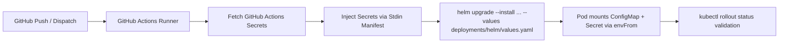

# Secret Management & CI/CD Secret Injection

This document describes the secret management architecture and automated CI/CD secret injection pipeline for the `rag-inference-serving` microservice.

---

## 1. Architectural Model: ConfigMap vs. Secret Decoupling

To ensure zero credential leakage and adhere to enterprise compliance, runtime configuration is bifurcated:

1. **Non-Sensitive Configurations (Kubernetes ConfigMap)**:

   - Sourced directly from `.env.prod`.
   - Synchronized to `deployments/helm/values.yaml` via `python scripts/sync_env_to_deployments.py --sync`.
   - Enforced by pre-commit hooks and GitHub Actions CI drift verification (`--check-only`).
   - Pods restart automatically via `checksum/config` sha256 annotation in `deployments/helm/templates/deployment.yaml`.
2. **Sensitive Credentials (Kubernetes Secret)**:

   - Never stored in `.env.prod`, `values.yaml`, or Git history.
   - Automatically excluded by `scripts/sync_env_to_deployments.py` matching `PASSWORD`, `SECRET`, `TOKEN`, `KEY`.
   - Injected dynamically at deployment time via GitHub Actions (`.github/workflows/deploy.yml`) into the Kubernetes cluster.
   - Injected into the container via `envFrom.secretRef` pointing to `rag-inference-secrets`.

---

## 2. GitHub Actions Secrets Inventory

Configure the following secrets in **GitHub Repository Settings &rarr; Secrets and variables &rarr; Actions**:

| Secret Name                    | Purpose                                                                | Target Microservice Env Variable |
| :----------------------------- | :--------------------------------------------------------------------- | :------------------------------- |
| `KUBECONFIG`                 | Base64 or raw kubeconfig granting deployment access to target cluster  | *Deployment context only*      |
| `PROD_HF_TOKEN`              | Hugging Face token for downloading gated/private weights during export | `HF_TOKEN`                     |
| `PROD_AWS_ACCESS_KEY_ID`     | Storage access key for AWS S3, MinIO, or Cloudflare R2                 | `AWS_ACCESS_KEY_ID`            |
| `PROD_AWS_SECRET_ACCESS_KEY` | Storage secret key for AWS S3, MinIO, or Cloudflare R2                 | `AWS_SECRET_ACCESS_KEY`        |
| `PROD_RAG_SERVING_API_KEY`   | Bearer token securing administrative endpoints (`/metrics`)          | `RAG_SERVING_API_KEY`          |
| `PROD_KAFKA_SASL_PASSWORD`   | Password for Kafka SCRAM-SHA-512 authentication (KEDA triggers)        | `KAFKA_SASL_PASSWORD`          |

---

## 3. Automated Injection Flow (`.github/workflows/deploy.yml`)

When code merges into `main` or `master`:



### Safe Injection Command:

```bash
cat <<EOF | kubectl apply -f -
apiVersion: v1
kind: Secret
metadata:
  name: rag-inference-secrets
  namespace: rag-inference-serving
type: Opaque
stringData:
  HF_TOKEN: "${HF_TOKEN}"
  AWS_ACCESS_KEY_ID: "${AWS_ACCESS_KEY_ID}"
  AWS_SECRET_ACCESS_KEY: "${AWS_SECRET_ACCESS_KEY}"
  RAG_SERVING_API_KEY: "${RAG_SERVING_API_KEY}"
  KAFKA_SASL_PASSWORD: "${KAFKA_SASL_PASSWORD}"
EOF
```

---

## 4. Pod-Level Consumption

In `deployments/helm/templates/deployment.yaml`:

```yaml
containers:
  - name: inference-worker
    envFrom:
      - configMapRef:
          name: {{ .Release.Name }}-config
      {{- if .Values.env.secretName }}
      - secretRef:
          name: {{ .Values.env.secretName }}
      {{- end }}
```

When `env.secretName` is set to `rag-inference-secrets`, Kubernetes injects all secret keys directly into the process environment without exposing their values in manifests.
