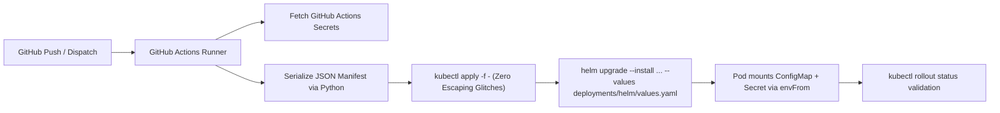

# Secret Management & CI/CD Secret Injection

This document describes the secret management architecture and automated CI/CD secret injection pipeline for the `rag-inference-serving` microservice.

---

## 1. Architectural Model: ConfigMap vs. Secret Decoupling

To ensure zero credential leakage and adhere to enterprise compliance, runtime configuration is bifurcated:

1. **Non-Sensitive Configurations (Kubernetes ConfigMap)**:

   - Sourced directly from `.env.prod`.
   - Synchronized to `deployments/helm/values.yaml` via `python scripts/sync_env_to_deployments.py --sync`.
   - Enforced by pre-commit hooks and GitHub Actions CI drift verification (`--check-only`).
   - Pods restart automatically via `checksum/config` sha256 annotation in `deployments/helm/templates/deployment.yaml`.
2. **Sensitive Credentials (Kubernetes Secret)**:

   - Never stored in `.env.prod`, `values.yaml`, or Git history.
   - Automatically excluded by `scripts/sync_env_to_deployments.py` matching `PASSWORD`, `SECRET`, `TOKEN`, `KEY`.
   - Injected dynamically at deployment time via GitHub Actions (`.github/workflows/deploy.yml`) into the Kubernetes cluster.
   - Injected into the container via `envFrom.secretRef` pointing to `rag-inference-secrets`.

---

## 2. GitHub Actions Secrets Inventory

Configure the following secrets in **GitHub Repository Settings &rarr; Secrets and variables &rarr; Actions**:

| Secret Name                    | Purpose                                                                | Target Microservice Env Variable |
| :----------------------------- | :--------------------------------------------------------------------- | :------------------------------- |
| `KUBECONFIG`                 | Raw, plaintext kubeconfig granting deployment access to target cluster | *Deployment context only*      |
| `PROD_HF_TOKEN`              | Hugging Face token for downloading gated/private weights during export | `HF_TOKEN`                     |
| `PROD_AWS_ACCESS_KEY_ID`     | Storage access key for AWS S3, MinIO, or Cloudflare R2                 | `AWS_ACCESS_KEY_ID`            |
| `PROD_AWS_SECRET_ACCESS_KEY` | Storage secret key for AWS S3, MinIO, or Cloudflare R2                 | `AWS_SECRET_ACCESS_KEY`        |
| `PROD_RAG_SERVING_API_KEY`   | Bearer token securing administrative endpoints (`/metrics`)          | `RAG_SERVING_API_KEY`          |
| `PROD_KAFKA_SASL_USERNAME`   | Username for Kafka SCRAM-SHA-512 authentication (KEDA triggers)        | `KAFKA_SASL_USERNAME`          |
| `PROD_KAFKA_SASL_PASSWORD`   | Password for Kafka SCRAM-SHA-512 authentication (KEDA triggers)        | `KAFKA_SASL_PASSWORD`          |

> [!IMPORTANT]
> **KEDA Kafka Trigger Authentication**: Injecting `KAFKA_SASL_PASSWORD` into the worker pod environment alone does **not** provide credentials to KEDA. The KEDA operator runs as an external controller in its own namespace and queries Kafka broker lag independently. KEDA requires explicit authentication configured via a `TriggerAuthentication` resource that references `KAFKA_SASL_USERNAME` and `KAFKA_SASL_PASSWORD` from `rag-inference-secrets`, coupled with `sasl: scram_sha512` and `tls: enable` in the trigger metadata.

---

## 3. Automated Injection Flow (`.github/workflows/deploy.yml`)

When code merges into `main` or `master`:



### Safe Injection Command (JSON Serialization via Python):

To preserve quotes, backslashes, and special characters exactly without shell escaping bugs or heredoc interpolation errors, credentials are serialized directly to JSON and piped to `kubectl apply`:

```bash
python3 -c '
import json, os, sys
secret = {
    "apiVersion": "v1",
    "kind": "Secret",
    "metadata": {
        "name": "rag-inference-secrets",
        "namespace": "rag-inference-serving",
    },
    "type": "Opaque",
    "stringData": {
        "HF_TOKEN": os.environ.get("HF_TOKEN", ""),
        "AWS_ACCESS_KEY_ID": os.environ.get("AWS_ACCESS_KEY_ID", ""),
        "AWS_SECRET_ACCESS_KEY": os.environ.get("AWS_SECRET_ACCESS_KEY", ""),
        "RAG_SERVING_API_KEY": os.environ.get("RAG_SERVING_API_KEY", ""),
        "KAFKA_SASL_USERNAME": os.environ.get("KAFKA_SASL_USERNAME", ""),
        "KAFKA_SASL_PASSWORD": os.environ.get("KAFKA_SASL_PASSWORD", ""),
    },
}
json.dump(secret, sys.stdout)
' | kubectl apply -f -
```

---

## 4. Headless Services & gRPC Round-Robin Resolution

Client-side round-robin load balancing via gRPC (`dns:///...`) requires headless Kubernetes Services (`clusterIP: None`) so CoreDNS resolves the A/AAAA records of individual pod endpoints rather than a single virtual ClusterIP.

To ensure existing Helm releases can upgrade cleanly without attempting an immutable `spec.clusterIP` change on the primary service, the Helm chart introduces a dedicated headless Service named `{{ .Release.Name }}-headless` (e.g. `rag-inference-online-embedding-headless`). The primary Service (`{{ .Release.Name }}`) retains its assigned ClusterIP for standard HTTP/metrics/readiness routing.

---

## 5. Pod-Level Consumption

In `deployments/helm/templates/deployment.yaml`:

```yaml
containers:
  - name: inference-worker
    envFrom:
      - configMapRef:
          name: {{ .Release.Name }}-config
      {{- if .Values.env.secretName }}
      - secretRef:
          name: {{ .Values.env.secretName }}
      {{- end }}
```

When `env.secretName` is set to `rag-inference-secrets`, Kubernetes injects all secret keys directly into the process environment without exposing their values in manifests.
